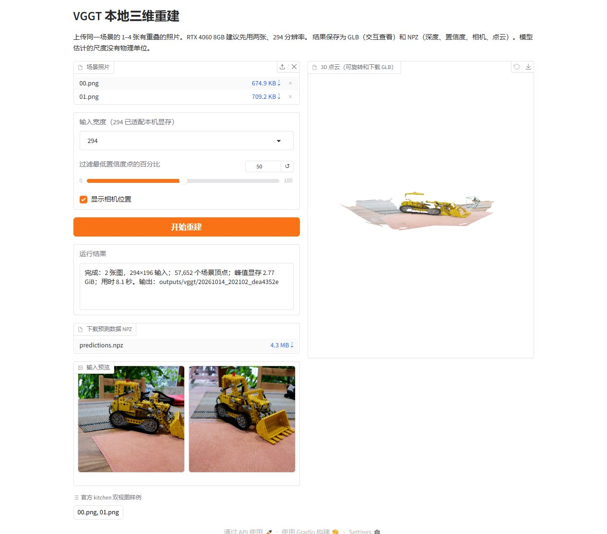

# 3D 重建中文实操指南

面向中文用户的 DUSt3R、MASt3R、VGGT 安装与本地 Demo 指南。从独立环境、官方源码和权重开始，完成双图重建、三维查看以及 GLB / NPZ 导出。

Chinese practical guides for DUSt3R, MASt3R and VGGT on Windows with NVIDIA GPUs.

**当前已验证：Windows x64 + RTX 4060 Laptop 8 GB，三模型独立环境、真实 GPU 推理、网页上传/显示/下载。** 先用官方双图样例验收，再增加自己的输入。模型尺度和精度不能仅凭场景显示判断。

## 从这里开始

| 顺序 | 操作 | 入口 |
|---|---|---|
| 01 | 安装 Git / Conda，获取固定源码，建立独立环境，配置权重与解释器 | [Windows 安装教程](docs/windows-setup.md) |
| 02 | 选择一个模型，按样图操作完成首次重建 | [DUSt3R](docs/models/dust3r.md) · [MASt3R](docs/models/mast3r.md) · [VGGT](docs/models/vggt.md) |
| 03 | 检查报错、显存、端口和下载问题 | [故障排查](docs/troubleshooting.md) |
| 04 | 核对哪些步骤实际运行过、什么仍未验证 | [验证记录](docs/validation.md) |
| 05 | 补充教程、报告问题或接入新模型 | [贡献指南](CONTRIBUTING.md) |

仅克隆不会安装依赖或下载权重。完成安装教程后再双击三个启动 CMD。源码全部来自公开的官方仓库；DUSt3R 的网页补丁单独保存，不需要作者的私有源码仓库。

```powershell
git clone --recurse-submodules https://github.com/AlbertXXuu/3D-Reconstruction-Guide-ZH.git
if ($LASTEXITCODE -ne 0) { throw 'Clone failed; check network and repository access' }
Set-Location -LiteralPath '3D-Reconstruction-Guide-ZH' -ErrorAction Stop
powershell.exe -NoProfile -ExecutionPolicy Bypass -File .\scripts\apply-source-patches.ps1
if ($LASTEXITCODE -ne 0) { throw 'Source patch failed; inspect the error before continuing' }
```

## 三个模型怎么选

| 模型 | 本指南提供的流程 | 首次设置 | 启动入口 |
|---|---|---|---|
| DUSt3R | 全局对齐，网格/点云及 RGB、深度、置信度查看 | Chateau 双图，512，100 iterations | [启动DUSt3R.cmd](启动DUSt3R.cmd) |
| MASt3R | 匹配与 sparse global alignment，点云和相机导出 | Chateau 双图，512，coarse 30 / refinement 20 | [启动MASt3R.cmd](启动MASt3R.cmd) |
| VGGT | 相机与深度预测，反投影点云，GLB / NPZ 导出 | kitchen 双图，宽度 294 | [启动VGGT.cmd](启动VGGT.cmd) |

三个环境分别使用 `dust3r-demo`、`mast3r-demo`、`vggt-demo`，不混装页面依赖。统一启动器默认管理一套服务，切换时释放上一套的显存；结束后使用 [停止Demo.cmd](停止Demo.cmd)。它只监听本机，不创建公开分享。

本项目提供可复现操作和实测记录，模型由原作者提供。Linux、macOS、CPU 推理、训练、大规模输入、透明物体精度以及完整定位/跟踪流程不在当前已验证范围；新增路线须附自己的验证条件和证据。

## 实际运行示例

VGGT 官方 kitchen 双图，宽度 294：三维场景可查看，GLB 与 NPZ 实际下载后均能重新读取。



样图来自 [VGGT 固定源码的 kitchen 示例](https://github.com/facebookresearch/vggt/tree/a288dd0f14786c93483e45524328726ab7b1b4ce/examples/kitchen)，模型与样例的使用条件见[第三方归属说明](docs/third-party-notices.md)。

## 清楚的目录

```text
README.md                 # 第一入口
docs/                     # 安装、模型操作、排错、验证
  models/                 # 每个模型一份操作页
  environments/           # Python 基础与固定直接依赖
scripts/                  # 启动、检查、smoke、源码补丁入口
patches/                  # 明确标注的第三方源码补丁
repos/                    # 官方源码子模块，按固定提交还原
workspace.example.json    # 通用配置模板
checkpoints/ data/ outputs/ # 本机权重、输入、结果；不提交
```

`workspace.json` 是安装教程生成的本机配置，不随仓库分发。新增内容使用既有结构，先提交可验收的一条流程，再扩展支持范围；详见[文档导航](docs/README.md)和[模型目录](docs/models/README.md)。

## 来源、许可与维护

官方项目：[DUSt3R](https://github.com/naver/dust3r)、[MASt3R](https://github.com/naver/mast3r)、[VGGT](https://github.com/facebookresearch/vggt)。固定提交、权重 URL 与校验基线见 [model-sources.json](docs/model-sources.json)，源码补丁和第三方许可见[归属说明](docs/third-party-notices.md)。

原创维护脚本、启动器和配置模板采用 [MIT](LICENSE)，原创教程采用 [CC BY 4.0](LICENSE-DOCS.md)。这些授权不包含第三方源码、补丁、模型、权重和样图，也不改变其非商业等使用限制。

安装定义固定直接依赖，传递依赖仍由 pip 解析。后续版本变更需要重新验证受影响的流程；修正文档、补充真实故障案例和提交其他硬件的运行记录都欢迎通过 Issue / Pull Request 参与。
